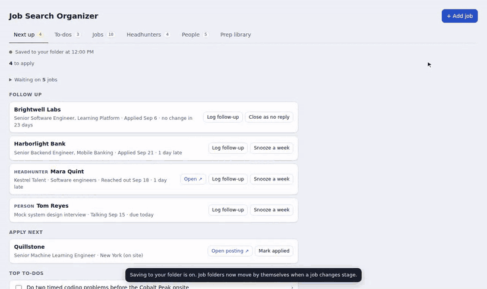
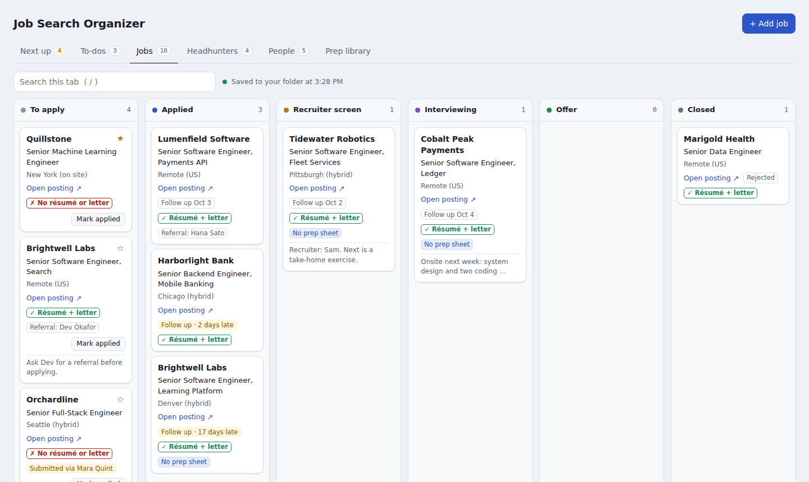
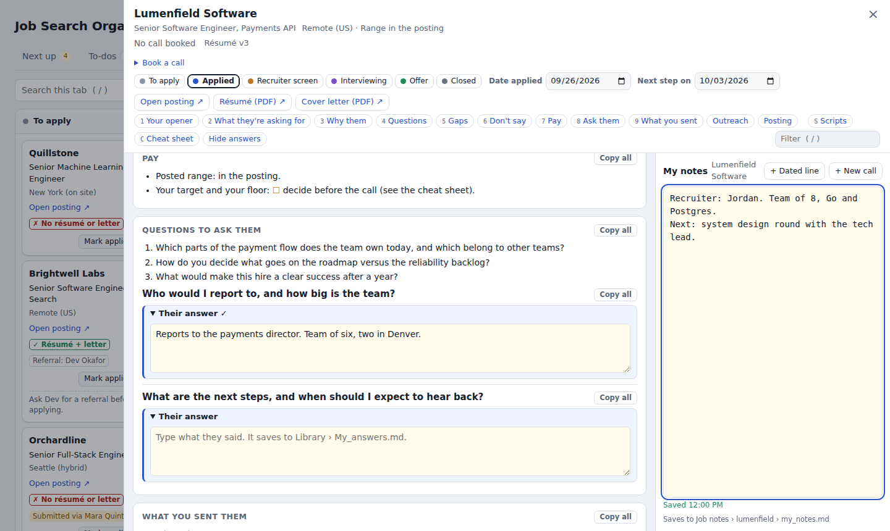
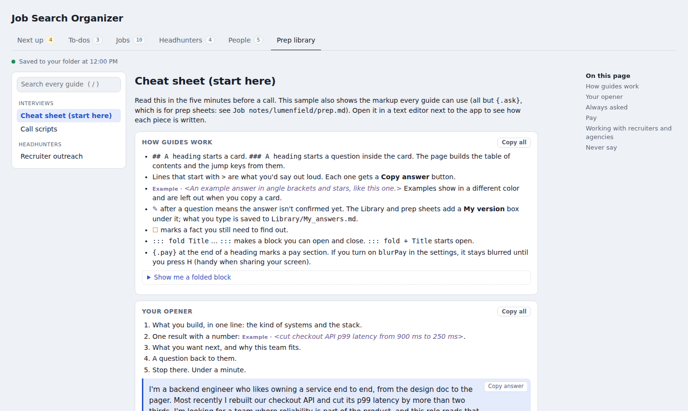
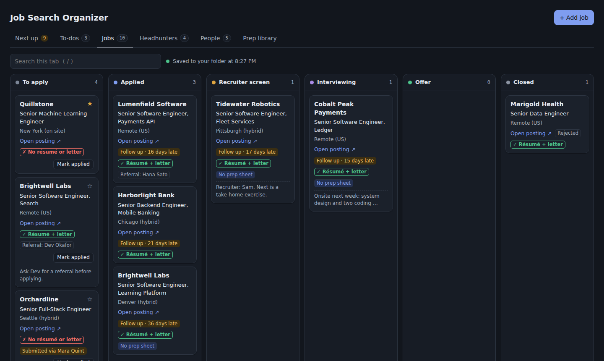

# Job Search Organizer

**A job search board your AI assistant keeps up to date.** Tell ChatGPT, Claude or any AI assistant what happened (you applied, a recruiter emailed, a call got booked) and it updates the board, moves the cards and writes your interview prep. You open one HTML file to see where everything stands. It's all plain files in a folder on your own computer: no server, no account, no install.

[](https://github.com/heat23/job-search-organizer/actions/workflows/ci.yml)   

### [▶ Try the live demo](https://heat23.github.io/job-search-organizer/)

A made-up senior engineer's job search, running in your browser. Nothing to install and nothing uploaded.

[](https://heat23.github.io/job-search-organizer/)

## How it works

1. **You talk to your assistant** in plain words: *"I applied to Lumenfield today with résumé v3."*
2. **It edits the files** in your board folder, following [`AGENTS.md`](boards/empty/AGENTS.md), the instructions every board folder includes for AI assistants.
3. **You switch back to the page.** The changes are there, tagged **New from assistant**. The job's résumé folder has moved to its new stage and follow-up dates are set. The prep sheet is ready for your call.

You can still drag cards and edit everything by hand, but the idea is that you don't have to.

## Use it with your AI assistant

**If your assistant can work in a folder on your computer** (the Claude desktop app with the folder added, Claude Code, Codex, Cursor, Gemini CLI and similar), point it at your board folder. It reads `AGENTS.md` and edits the files directly. Start a new chat with:

```
Read AGENTS.md in my job search folder. From now on, keep my board up to date as I tell you what happens.
```

**If you use a chat in the browser** (ChatGPT, Claude or Gemini), attach `board_data.js` and `AGENTS.md`, ask for your change, then save the file it gives back over the old one (check first that it starts with the comment lines and `window.BOARD_DATA = {` and holds only data; see [Your data](#your-data-stays-on-your-computer)). For a prep sheet, ask for `prep.md` and save it in `Job notes/<job id>/`. If the file you get back is missing something, nothing is lost: the page keeps its own copy of every record and writes back anything missing.

> Your board stays on your computer, but whatever you paste into a cloud AI tool is sent to that provider. Check its data settings before you share your résumé or notes.

### Prompts to try

**Add jobs**
```
Add this job to my board and save the posting to posting.md: https://jobs.example.com/acme/staff-engineer
```
```
Here are six links from today's job alerts. Add the ones that fit a senior backend role. Star the two best fits and mark anything above my level as a long shot.
```

**Keep the board current**
```
I applied to the Brightwell Labs Search role today with résumé v2. Move it to Applied.
```
```
Here's an email from the Tidewater recruiter: [paste]. Update the board: book the call, move the card, and add a to-do for anything I need to send.
```
```
Harborlight turned me down. Close it as Rejected.
```

**Prepare for calls**
```
My call with Tidewater is Thursday at 2 pm with the hiring manager. Write Job notes/tidewater/prep.md from the posting and my résumé (attached). Keep each section short, and mark any answer you're not sure I'd give with ✎.
```
```
Read my notes from the Tidewater call in Job notes/tidewater/my_notes.md. Move it to Interviewing, set the follow-up, and add a to-do to send a thank-you note today.
```
```
Turn my notes on behavioral questions into a guide at Library/1_Interviews/03_Behavioral.md, using the same markup as the cheat sheet.
```

**Stay on top of it**
```
What's due this week? List late follow-ups with a two-line follow-up email for each, and close anything that has had no reply for three weeks.
```
```
Mara at Kestrel Talent wants to submit me to Fernhill. Tell me first if I've already applied there myself, then update her card.
```
```
Jamie Chen offered to refer me to Quillstone. Add Jamie to People and link them to the Quillstone job.
```

## What it does

| | |
|---|---|
|  |  |
| **Boards.** Jobs, headhunters and people in lanes, with drag and drop, follow-up dates, stale-card nudges and undo. | **Prep sheets.** Your talking points and a notes pad side by side. Book a call and the card moves forward on its own. |
|  |  |
| **Prep library.** Markdown guides with search, copy buttons and a "My version" box for your own answers. | **Dark mode**, keyboard shortcuts, quick open (G) and a layout for half a screen next to a video call. |

It also:

- Moves each job's résumé and cover-letter folder into a stage folder (`1 - To apply`, `2 - Applied`, `3 - Closed`) when the card changes lane. With saving on, it also flags an open job whose résumé or cover letter PDF isn't in its folder (closed jobs aren't flagged).
- Shows **Next up** each morning: follow-ups due, upcoming calls, starred jobs, top to-dos and your plan.
- Warns you before you apply somewhere a headhunter has already submitted you.
- Backs up your data and notes every day, with an optional second copy on another drive.

## Try it

- **In your browser:** open the [live demo](https://heat23.github.io/job-search-organizer/). Everything runs in the page, and a reload starts over.
- **On your computer:** click **Code → Download ZIP**, unzip it, and open `boards/sample/organizer.html` in Chrome or Edge. Click **Turn on saving** and pick the `boards/sample` folder to see real saving.

## Start your own board

1. Copy the **`boards/empty`** folder somewhere private, for example `Documents/Job Search`.
2. Open `organizer.html` from that folder, click **Turn on saving** and pick the same folder.
3. Point your AI assistant at the folder (see above). `AGENTS.md` is already there.
4. Optional: open `organizer.config.js` in a text editor to set your name, file names, lane names, call types or stage folders (see [Settings](#settings)).

To start from the sample guides, copy the `.md` files under `boards/sample/Library` into your own `Library` folder.

### Settings

`organizer.config.js` holds your settings. Anything you leave out keeps its default; the full list is in [`src/js/00-config.js`](src/js/00-config.js). Reload the page after a change.

- **Lanes.** Lane ids (`todo`, `applied`, `screen`, `interview`, `offer`, `closed`, and the ones under `hunters` and `people`) are fixed: the data file, `AGENTS.md` and the page rely on them. A lane's `name`, `color` and `follow` (follow-up days) are yours to change. Your list replaces the default one, so list every lane by its id; a lane keeps the default settings you leave out. If a lane is missing, the page adds the default one back and logs a warning in the browser console.
- **Call types.** Each one is `{ label, moves }`. `label` is what the booking box shows and what's stored on the card. `moves` sets where booking that call moves a job: `"screen"` (Applied → Recruiter screen), `"interview"` (Applied or Recruiter screen → Interviewing) or `"none"`. Because the move comes from `moves`, you can rename the labels:

  ```js
  callTypes: [
    { label: "Intro call", moves: "screen" },
    { label: "Team interview", moves: "interview" },
    { label: "Coffee chat", moves: "none" },
  ],
  ```

  Plain strings from older settings still work, and so do cards booked under a label you later renamed.

The four-week plan on the Headhunters tab is a sample you can edit or empty (the empty board starts without one): its steps are the `plan` records in `board_data.js`, which your assistant can rewrite, and `plan.*` in the config renames it. The Headhunters tab works for any agency or in-house recruiter, and `sections.*` in the config renames it and the People tab.

## Your data stays on your computer

```
Job Search/
├── organizer.html          the app (open this)
├── organizer.config.js     your settings (optional)
├── AGENTS.md               instructions for your AI assistant (CLAUDE.md points to it)
├── board_data.js           jobs, headhunters, people, to-dos, plan (JSON)
├── 1 - To apply/           one folder per job: Resume.pdf, Cover_Letter.pdf
├── 2 - Applied/  3 - Closed/  4 - Removed/
├── Job notes/<job>/        prep.md, my_notes.md, outreach.md, posting.md
├── Library/                your guides (Markdown), My_answers.md
└── backups/                daily copies of the data file and your notes
```

- Chrome and Edge can write to a folder you pick (the [File System Access API](https://developer.mozilla.org/docs/Web/API/File_System_API)). Other browsers open the page as view-only.
- Every change is also kept in the browser, so nothing is lost if saving pauses. If a notes file changes on disk while you type, both versions are kept.
- Everything is plain text, so you can read it, search it or back it up with any tool, and it still works if this project goes away.
- **`board_data.js` and `organizer.config.js` are loaded by the page as scripts**, so whatever is in them runs in the page, which can read and write your board folder. Only let tools you trust write them. An AI assistant should change only the JSON object in `board_data.js` and never add code (`AGENTS.md` tells it so). The page reads the file from your folder with a JSON parser, never runs it again, and warns you if it holds anything besides the comment lines and `window.BOARD_DATA = {…};`. That warning comes after the page has loaded the file, so treat it as a check, not a protection.

## Guides and prep sheets

Guides are ordinary Markdown with a few extras. The sample guides show every one of them except `{.ask}`, which is for prep sheets (see `boards/sample/Job notes/lumenfield/prep.md`).

| Write | Shows as |
|---|---|
| `## Section` / `### Question` | a card (with a jump key on a prep sheet) / a question in it (with a Copy button) |
| `> What you'd say` | an answer with a Copy answer button |
| `*<example answer>*` | an example, in a different color, left out when you copy |
| `✎` / `☐` | not confirmed yet (adds a "My version" box, in the Library and on prep sheets) / a fact to find out |
| `### Question {.ask}` | on a prep sheet, an open "Their answer" box for what the interviewer said |
| `::: fold Title` … `:::` | a block you can open and close |
| `## Pay {.pay}` | a pay section (optionally blurred until you press H, for screen sharing) |

A job gets a prep sheet as soon as `Job notes/<job id>/prep.md` exists. It opens by itself for a job from Applied through Offer, for a job with a call booked (unless it's closed), or straight away for a job with `sheet: true`; any other job with a prep sheet gets an **Open prep sheet** button. What you type in the answer boxes is saved to `Library/My_answers.md`, never to the guides. The page reads that file and merges it before every write, so a second browser or computer never overwrites answers it doesn't have. If your assistant rewords a question you already answered, your answer is listed under **Saved answers from earlier versions** at the end of the sheet. Your assistant knows this markup from `AGENTS.md`.

## How it's built

- **No framework, no runtime dependencies.** 18 small plain-JavaScript files under `src/`, joined by an 80-line build script into one HTML file that runs from `file://`.
- **Safe with other writers.** When the page and another tool both change a record, they merge field by field (each side keeps the fields it changed, and the newer `updatedAt` wins a field both changed), also after a reload. A tool that writes back an older copy of the file never undoes what you saved: records older than your saved version are ignored and written back. Nothing is hard-deleted, and a notes file that changed on disk is never overwritten, so you, the page and your AI assistant can all edit the same folder. Tests cover an assistant editing files while the page is open.
- **Tested in a real browser.** 441 Playwright checks run in CI against an in-memory folder that implements the File System Access API. The same in-memory folder powers the live demo.
- **Private.** Guides are escaped before rendering, and a test fails if the page makes any network request.

More in [docs/ARCHITECTURE.md](docs/ARCHITECTURE.md).

## Development

```sh
npm install
npx playwright install chromium   # once, for the tests
npm run build                     # src/ -> boards/*/organizer.html
npm test                          # 441 browser checks
npm run demo                      # the live demo page -> _site/index.html
```

See [CONTRIBUTING.md](CONTRIBUTING.md) to help.

## License

[MIT](LICENSE) © 2026 Sudhir Prakash. The sample board is a fictional senior software engineer's search: every company, person and link in it is made up.
