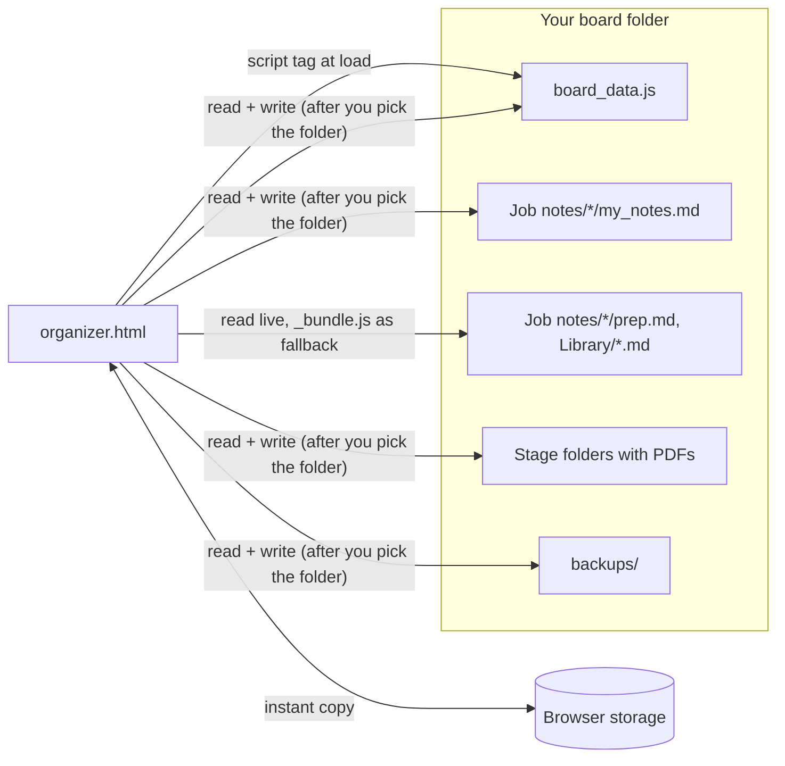

# Architecture

A single HTML page that runs from disk (`file://`), with no server and no framework. The browser's [File System Access API](https://developer.mozilla.org/docs/Web/API/File_System_API) lets it read and write the folder it lives in, once you pick that folder.

## Source layout

| File | What it does |
|---|---|
| `src/js/00-config.js` | Every personal choice (lanes, call types, folder and file names, follow-up days, picker ids). Merged with `organizer.config.js`, then checked: lane ids are fixed, so a missing lane is added back with a console warning. |
| `src/js/30-store.js` | The data model: five collections of records keyed by id, and the per-field revision merge of the file, the browser's copy and other tabs. |
| `src/js/40-storage.js` | Saving to the folder, the daily data backup, and moving job folders between stage folders. |
| `src/js/50-render.js` … `70-drawer.js` | Next up, the boards, cards, to-dos, the plan and the card panel. |
| `src/js/80-markdown.js` | The Markdown subset and markup for guides. Input is escaped first; only http(s) links are rendered. |
| `src/js/81-*.js` … `88-*.js` | Guides and prep sheets, My_answers.md, the notes pad, calls, quick open, the Library tab, note backups and Restore a backup. |
| `src/js/90-boot.js` | Wiring and start-up. |
| `tools/build.mjs` | Joins the files into one `organizer.html` per board folder and fails on duplicate top-level names. |

The scripts are classic scripts joined in file-name order, not ES modules, because browsers block modules on `file://` pages.

## Keeping data safe

- **Two copies, merged field by field by revision numbers kept in the file.** Every change is stored in the browser at once and written to `board_data.js` 400 ms later. A record may carry `revs`, an object of field name → whole number (a missing entry is 0). Whoever changes a field, the page or another tool, sets `revs[field]` to the old value + 1; `updatedAt` and `changedBy` are only shown, never compared, so clocks play no part. Because the numbers live in the file, every browser, a fresh profile and a browser whose site data was cleared all decide the same way. The browser's copy also keeps, per record, its **dirty** fields: the fields changed in this browser and not yet written to the file (stored with the copy in browser storage, shared by open tabs). After a successful write, exactly the fields that were written become clean; a field changed again during the write stays dirty. When the file's record F is merged into the browser's record L, for each field (`deleted` and `removedAt` are ordinary fields):
  - **F's number is higher:** F's value and number are taken, unless the field is dirty in L: then it is a conflict. L's value is kept with the number F's + 1 (so it wins once written), recorded.
  - **F's number is lower:** L is kept: the file holds an older value, or L has an unsaved change. When the field isn't dirty, an older copy was written back: recorded.
  - **Equal numbers, equal values:** nothing to do.
  - **Equal numbers, different values:** a dirty field keeps L's value with the number + 1, recorded. A clean field takes F's value with the number + 1: an edit made without a bump, and with no local change the file is the shared truth.
  - **A record only one side has** is kept (a record the file lost is written back, recorded unless it was never written). The same new id on both sides merges by the same rule; a record never written is all dirty.

  "Recorded" means the file as it was goes to `backups/board_data_kept_<date>_<HHMM>.js` (the last 10 are kept), and the status line says "Kept your version of N fields on M cards; the file's version is in backups/…", one line per merge. The page never blocks or asks. Every page write path (drag, quick move, star, the panel's fields, dates, calls, closed reason, referral, filing a folder, Remove and Restore, to-dos, the plan, Restore a backup and its Undo, merges) goes through one function that bumps the number of each field whose value changes and marks it dirty; a test walks them. Before writing, the page checks the file's modification time and size again and merges first if another tool wrote it since the read. What is written is a snapshot. Open tabs share the copy and its dirty fields in browser storage; another tab's copy merges by the same rule (a tie goes to the later copy), and a change either tab hasn't written yet is never lost. Limits: a tool that bumps a field it didn't change, from an old read, wins a tie against a saved value; and a tool that changes a field without a bump while the same field has an unsaved change in the page loses to that change without a note (both against `AGENTS.md`).
- **Upgrading from a version before per-field revisions.** A browser copy stored by an older version (no dirty fields stored) is merged once the way that version did: per record, the newer `updatedAt` wins. The fields where the browser's winning record differs from the file become new edits (the file's number + 1) and dirty, so they are written and never lost, even if saving was never turned on. A record-level `rev` from an earlier version is ignored.
- **Restore a backup.** The footer's "Restore a backup…" lists `backups/board_data_*.js` (or takes any `.js` copy) with date and card counts. After a confirm it saves the current file as `backups/board_data_before_restore_<time>.js`, then every field of the backup that differs from the board becomes a new edit (its number + 1; cards added since then are removed the same way), so the restore wins in the file, in other tabs and in later merges. A full filing pass then moves each job folder to its restored stage folder, and the folder listing is refreshed. The toast (only the toast, not Ctrl+Z) offers Undo: it puts back each field the restore changed that hasn't changed since, keeps later changes (and says how many), and files the folders again. Copying an old file over `board_data.js` by hand restores nothing: its numbers aren't newer.
- **Never delete.** Removing a card sets `deleted: true`; the Removed list can restore it. A removed job's files wait in `4 - Removed` for 30 days.
- **Never overwrite unread text.** The notes pad re-reads `my_notes.md` before each write. If the file changed on disk, the other version is saved beside it as `my_notes.changed-on-disk-<time>.md`. `Library/My_answers.md` is read and merged before every write. A box changed in this browser since the last write wins, and other keys take the file's value. An answer missing from the file is never deleted from the browser; it is written back, so a file read cut short, empty or half-written deletes nothing. Deleting goes through the page (emptying a box, Remove, or "Clear all my answers…" in the Prep library). The removal is kept as a tombstone shared by open tabs, so no tab brings it back; another browser or computer that still has the answer writes it back. Deleting an answer from the file by hand isn't supported. If the file can't be read, the answers wait in the browser. A file that reads as empty or without its `# My answers` title is copied to `backups/` before it is written again. Prep-sheet answers are keyed by question and `## section`; an answer under an older key moves to a box only when that is certain (the question is on the sheet once and it is the only older answer), otherwise it is listed under "Saved answers from earlier versions".
- **Only real job folders move.** A job's `folder` must be a relative path inside the board that isn't a stage folder, `Library`, `Job notes` or `backups`; anything else is refused with a message, and a folder can never be copied into itself. Filing only looks at jobs whose stage or folder changed, with a full pass at start-up and after another tool's changes.
- **Data files are scripts.** `board_data.js` and `organizer.config.js` are loaded with `<script>` tags. Read from the folder, the data file is only JSON-parsed, and the page warns when anything besides comments surrounds `window.BOARD_DATA = {…};` (comments are read the way JavaScript reads them). The warning is a check after the fact, not a sandbox: the `<script>` tag has already run the file by then.
- **Refuse a broken file.** If `board_data.js` can't be parsed, the page keeps your changes in the browser and doesn't overwrite it.
- **Per-folder storage.** Browser storage is shared by all pages opened from disk, so every key carries the page's folder: the sample board and your own never mix.
- **Backups.** A daily copy of the data file (14 kept, taken on the first save of the day or at start-up on a day without edits; the copies saved before a restore are kept 14 too, and the versions a merge kept out 10) and of your notes (60 kept) in `backups/`, plus an optional daily copy of the whole folder somewhere else (5 kept).

## Tests

`npm test` runs 617 checks (13 suites) in headless Chromium against a copy of `boards/sample`. An in-memory folder (`src/demo/memfs.js`, with test hooks in `tests/ffs.js`) stands in for the folder picker, so the tests cover saving, conflicts, permission loss and write failures without touching the disk.

## The live demo

`tools/build-demo.mjs` turns the sample board into one page (`_site/index.html`) that GitHub Pages serves after CI passes. `src/demo/demo.js` fills the in-memory folder with the sample files, moves the sample's dates so they're relative to today, and hands the folder to the app through `window.ORGANIZER_FOLDER`. Because the folder API is provided in memory, the demo doesn't need Chrome's folder picker, so it is meant to run in Safari and Firefox too (the tests check it with the folder API removed). Nothing is uploaded, and a reload starts over.
