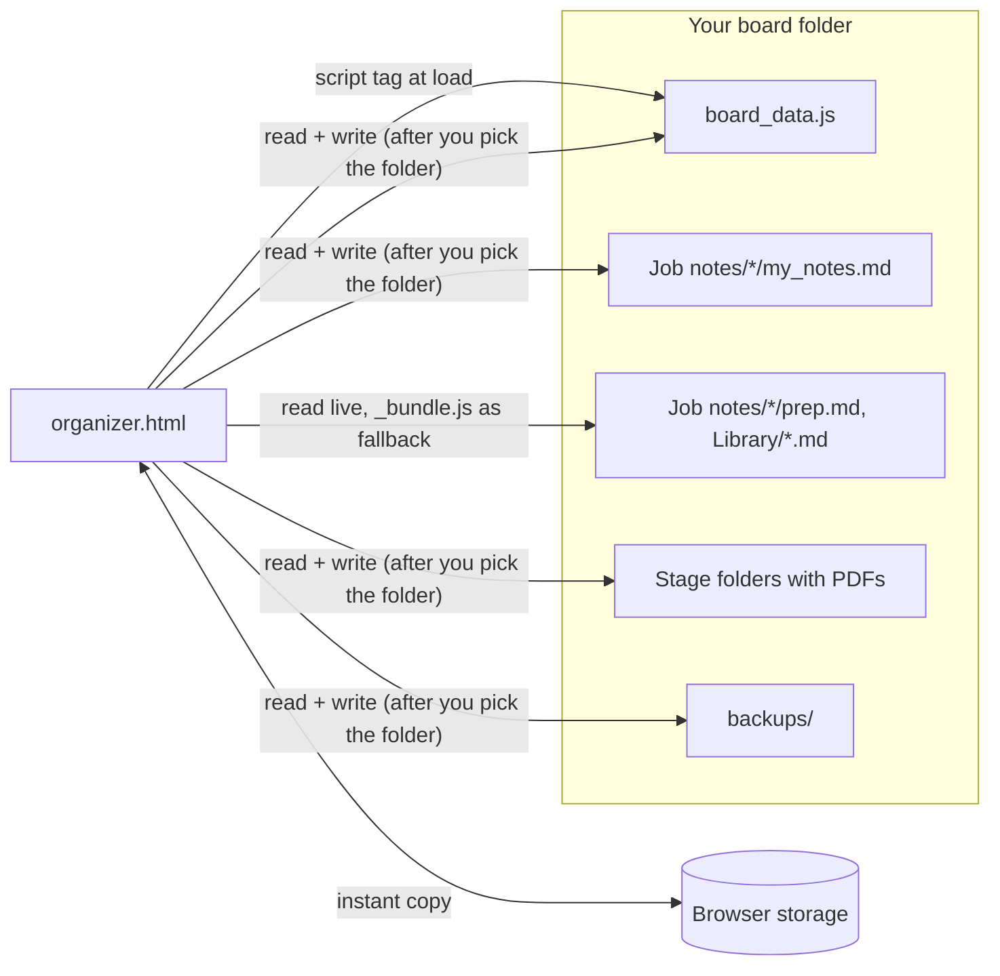

# Architecture

A single HTML page that runs from disk (`file://`), with no server and no framework. The browser's [File System Access API](https://developer.mozilla.org/docs/Web/API/File_System_API) lets it read and write the folder it lives in, once you pick that folder.

## Source layout

| File | What it does |
|---|---|
| `src/js/00-config.js` | Every personal choice (lanes, call types, folder and file names, follow-up days, picker ids). Merged with `organizer.config.js`, then checked: lane ids are fixed, so a missing lane is added back with a console warning. |
| `src/js/30-store.js` | The data model: five collections of records keyed by id, and the content-based, field-level merge of the file, the browser's copy and other tabs. |
| `src/js/40-storage.js` | Saving to the folder, the daily data backup, and moving job folders between stage folders. |
| `src/js/50-render.js` … `70-drawer.js` | Next up, the boards, cards, to-dos, the plan and the card panel. |
| `src/js/80-markdown.js` | The Markdown subset and markup for guides. Input is escaped first; only http(s) links are rendered. |
| `src/js/81-*.js` … `88-*.js` | Guides and prep sheets, My_answers.md, the notes pad, calls, quick open, the Library tab, note backups and Restore a backup. |
| `src/js/90-boot.js` | Wiring and start-up. |
| `tools/build.mjs` | Joins the files into one `organizer.html` per board folder and fails on duplicate top-level names. |

The scripts are classic scripts joined in file-name order, not ES modules, because browsers block modules on `file://` pages.

## Keeping data safe

- **Two copies, merged by content.** Every change is stored in the browser at once and written to `board_data.js` 400 ms later. For each record the page keeps a short history of the values the file held when it was read or written (the last five values of each field, as 32-bit hashes, stored compactly next to the browser's copy so it survives a reload). When the file's record differs from the browser's, each field is decided on its own (`deleted` and `removedAt` count as one field):
  - the file's value is one the history holds: an older copy written back (a tool saved what it read before your change). The browser's value stays and is written back; the file as it was goes to `backups/board_data_older_<date>.js` once a day, and the status line says "Kept your newer changes to N cards";
  - the file's value is new: another tool's edit, taken, unless the browser also changed that field since the last read. Then the later change wins: when the browser changed it, against the file record's `updatedAt`.

  `updatedAt` only breaks that tie. A stamp more than 5 minutes in the future is read as now, so it can't block later edits, and a date-only or mis-zoned stamp only matters in a tie. A record with no history (browser storage was full, which the status line says once) falls back to the newer `updatedAt`. Before writing, the page checks the file's modification time and size again and merges first if another tool wrote it since the read. What is written is a snapshot, so an edit made during the write stays unsaved and is written next. Open tabs share one copy in browser storage and merge each other's copies field by field by the time this browser last changed each field, so they settle on the latest change (an Undo too). On window focus the data file is read before the prep sheets are scanned.
  - The trade-off: a tool that sets a field back to a value it had recently (undoing the person's change) looks like an older copy and is kept out; `AGENTS.md` asks assistants to leave that to the person.
- **Restore a backup.** The footer's "Restore a backup…" lists `backups/board_data_*.js` (or takes any `.js` copy) with date and card counts. After a confirm it saves the current file as `backups/board_data_before_restore_<time>.js`, then replaces the records with the backup's, each stamped as a change made now (cards added since then are removed), so the restore wins in the file, in other tabs and in later merges; a toast offers Undo. Copying an old file over `board_data.js` by hand is read as an older copy and doesn't restore anything.
- **Never delete.** Removing a card sets `deleted: true`; the Removed list can restore it. A removed job's files wait in `4 - Removed` for 30 days.
- **Never overwrite unread text.** The notes pad re-reads `my_notes.md` before each write. If the file changed on disk, the other version is saved beside it as `my_notes.changed-on-disk-<time>.md`. `Library/My_answers.md` is read and merged before every write (a box changed in this browser since the last write wins; an answer the file lost since the last read stays deleted and is remembered as removed, so another tab can't bring it back; other keys take the file's value); if it can't be read, the answers wait in the browser, and open tabs share them key by key. A file that reads as empty, without its `# My answers` title, or with every answer gone at once deletes nothing: it is copied to `backups/` and written again from the browser ("Clear all my answers…" in the Prep library is the way to empty it). Prep-sheet answers are keyed by question and `## section`; an answer under an older key moves to a box only when that is certain (the question is on the sheet once and it is the only older answer), otherwise it is listed under "Saved answers from earlier versions".
- **Only real job folders move.** A job's `folder` must be a relative path inside the board that isn't a stage folder, `Library`, `Job notes` or `backups`; anything else is refused with a message, and a folder can never be copied into itself. Filing only looks at jobs whose stage or folder changed, with a full pass at start-up and after another tool's changes.
- **Data files are scripts.** `board_data.js` and `organizer.config.js` are loaded with `<script>` tags. Read from the folder, the data file is only JSON-parsed, and the page warns when anything besides comments surrounds `window.BOARD_DATA = {…};` (comments are read the way JavaScript reads them). The warning is a check after the fact, not a sandbox: the `<script>` tag has already run the file by then.
- **Refuse a broken file.** If `board_data.js` can't be parsed, the page keeps your changes in the browser and doesn't overwrite it.
- **Per-folder storage.** Browser storage is shared by all pages opened from disk, so every key carries the page's folder: the sample board and your own never mix.
- **Backups.** A daily copy of the data file (14 kept, taken on the first save of the day or at start-up on a day without edits; the older copies a merge kept and the copies saved before a restore are kept 14 each too) and of your notes (60 kept) in `backups/`, plus an optional daily copy of the whole folder somewhere else (5 kept).

## Tests

`npm test` runs 513 checks (11 suites) in headless Chromium against a copy of `boards/sample`. An in-memory folder (`src/demo/memfs.js`, with test hooks in `tests/ffs.js`) stands in for the folder picker, so the tests cover saving, conflicts, permission loss and write failures without touching the disk.

## The live demo

`tools/build-demo.mjs` turns the sample board into one page (`_site/index.html`) that GitHub Pages serves after CI passes. `src/demo/demo.js` fills the in-memory folder with the sample files, moves the sample's dates so they're relative to today, and hands the folder to the app through `window.ORGANIZER_FOLDER`. Because the folder API is provided in memory, the demo doesn't need Chrome's folder picker, so it is meant to run in Safari and Firefox too (the tests check it with the folder API removed). Nothing is uploaded, and a reload starts over.
