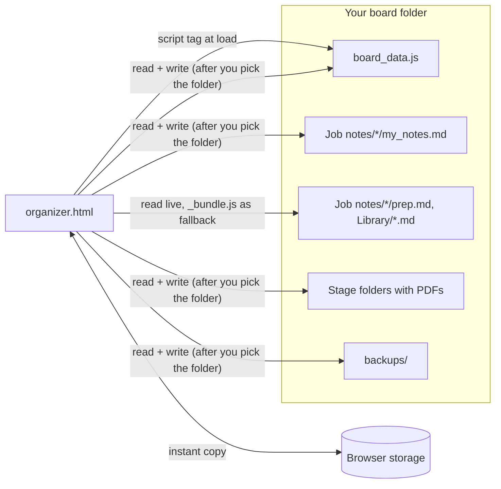

# Architecture

A single HTML page that runs from disk (`file://`), with no server and no framework. The browser's [File System Access API](https://developer.mozilla.org/docs/Web/API/File_System_API) lets it read and write the folder it lives in, once you pick that folder.

## Source layout

| File | What it does |
|---|---|
| `src/js/00-config.js` | Every personal choice (lanes, folder and file names, follow-up days, picker ids). Merged with `organizer.config.js`. |
| `src/js/30-store.js` | The data model: five collections of records keyed by id, merged by `updatedAt` so the newer edit wins. |
| `src/js/40-storage.js` | Saving to the folder, the daily data backup, and moving job folders between stage folders. |
| `src/js/50-render.js` … `70-drawer.js` | Next up, the boards, cards, to-dos, the plan and the card panel. |
| `src/js/80-markdown.js` | The Markdown subset and markup for guides. Input is escaped first; only http(s) links are rendered. |
| `src/js/81-*.js` … `88-*.js` | Guides and prep sheets, the notes pad, calls, quick open, the Library tab and note backups. |
| `src/js/90-boot.js` | Wiring and start-up. |
| `tools/build.mjs` | Joins the files into one `organizer.html` per board folder and fails on duplicate top-level names. |

The scripts are classic scripts joined in file-name order, not ES modules, because browsers block modules on `file://` pages.

## Keeping data safe

- **Two copies, newest wins.** Every change is stored in the browser at once and written to `board_data.js` 400 ms later. On load the two are merged record by record by `updatedAt`, so an edit made by another tool while the page was closed is kept.
- **Never delete.** Removing a card sets `deleted: true`; the Removed list can restore it. A removed job's files wait in `4 - Removed` for 30 days.
- **Never overwrite unread text.** The notes pad re-reads `my_notes.md` before each write. If the file changed on disk, the other version is saved beside it as `my_notes.changed-on-disk-<time>.md`.
- **Refuse a broken file.** If `board_data.js` can't be parsed, the page keeps your changes in the browser and doesn't overwrite it.
- **Per-folder storage.** Browser storage is shared by all pages opened from disk, so every key carries the page's folder: the sample board and your own never mix.
- **Backups.** A daily copy of the data file (14 kept) and of your notes (60 kept) in `backups/`, plus an optional daily copy of the whole folder somewhere else (5 kept).

## Tests

`npm test` runs 146 checks in headless Chromium against a copy of `boards/sample`. An in-memory folder (`src/demo/memfs.js`, with test hooks in `tests/ffs.js`) stands in for the folder picker, so the tests cover saving, conflicts, permission loss and write failures without touching the disk.

## The live demo

`tools/build-demo.mjs` turns the sample board into one page (`_site/index.html`) that GitHub Pages serves after CI passes. `src/demo/demo.js` fills the in-memory folder with the sample files, moves the sample's dates so they're relative to today, and hands the folder to the app through `window.ORGANIZER_FOLDER`. Because the folder API is provided in memory, the demo doesn't need Chrome's folder picker, so it is meant to run in Safari and Firefox too (the tests check it with the folder API removed). Nothing is uploaded, and a reload starts over.
